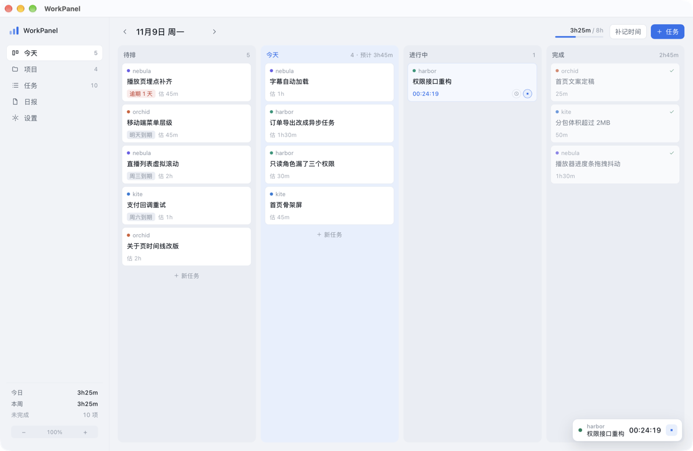
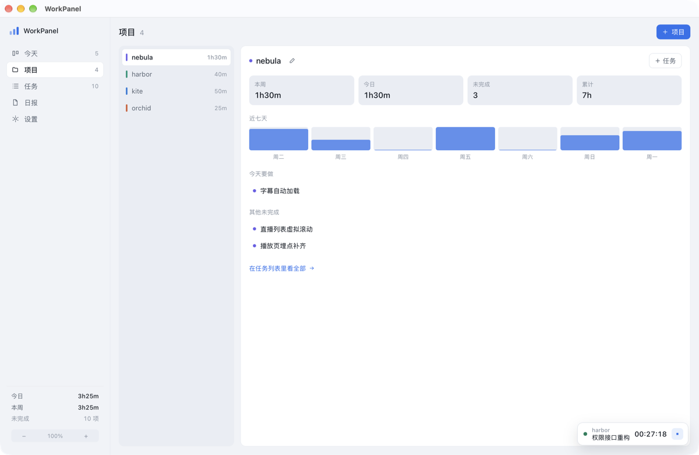
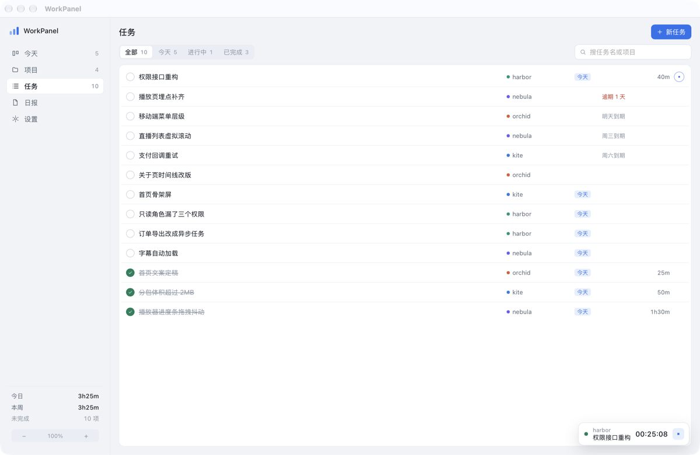
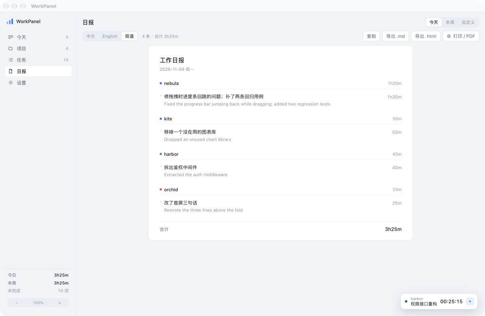

# WorkPanel

[](LICENSE)

A task board, a time tracker and a daily-report generator for people who run several projects at once. Local-first: everything lives in one SQLite file on your own machine.

Standalone desktop app built with Tauri 2 + Vue 3. Runs on macOS and Windows. No account, no cloud sync, no network access unless you switch on AI translation.

**English** · [中文说明](README.zh-CN.md)



> Screenshots use made-up demo data, not real projects.

## The problem

When you juggle several projects, you switch between them all day and some tasks only get done days later. At the end of the day you still owe a report: what you did per project, how long it took, one or two sentences each.

WorkPanel puts the three things in one window:

- **Tasks organised by project** — four columns: Backlog / Today / Doing / Done. Drag a card to change the plan.
- **Time logged as you go** — a timer on every card, or add an entry afterwards.
- **A report that writes itself** — grouped by project, one line per task, Chinese / English / bilingual.

## Features

### Board

Four columns, and you can drag cards between any two of them: **Backlog → Today → Doing → Done**.

- **Drop on Today** — plans the task for today. Dragging a card out of Doing first settles the running timer, then puts the card back in today's list.
- **Drop on Doing** — starts work and the timer. If that task is already being timed, it won't start a second one.
- **Drop on Done** — marks it done and stops the timer. Dragging a finished card back to Today reopens it.
- **Drop on Backlog** — clears the planned date and returns it to the pool.

Each card has two buttons on hover: **⏱ log time manually** and **▶ start timer**. So both "I forgot to hit start" and "I'm doing it right now" work.

The column header shows `N · est 3h45m · logged 1h25m`, so you can see at a glance whether today's work actually fits.

### Projects

The list on the left is sorted by this week's hours. The right panel shows this week / today / open tasks / total hours, a 7-day bar chart, and what this project has planned for today.



### Tasks

A flat table of every task, filterable by All / Today / Doing / Done, searchable by task or project name.



### Report

Pick a range (today / this week / custom) and a language (Chinese / English / bilingual) and the report appears as you go. Copy it, export `.md`, export `.html`, or print straight to PDF.

Several entries on the same task collapse into one line: notes are split, de-duplicated, joined with `；` and clipped to 72 characters.



### Interface language

The UI itself switches between Chinese and English. Use the `中 / EN` toggle at the top of the sidebar, or the language selector in Settings. The choice is remembered.

This is independent of the report language: you can run the interface in English and still produce a Chinese report.

### Zoom

The window is 1040×640 minimum. When the text is too small, scale the whole interface:

| Action | Shortcut |
| --- | --- |
| Zoom in | `⌘ +` / `Ctrl +` |
| Zoom out | `⌘ -` / `Ctrl -` |
| Back to 100% | `⌘ 0` / `Ctrl 0` |

There is also a `− 100% +` control at the bottom of the sidebar. Steps are 80 / 90 / 100 / 110 / 125 / 140 / 160%, and the choice is remembered.

### AI (optional)

Only called when you hit **Translate** in the report or **Rewrite** in the entry dialog. Any OpenAI-compatible endpoint works:

| Field | Example |
| --- | --- |
| Endpoint | `https://api.deepseek.com/v1` |
| Model | `deepseek-chat` |
| API key | `sk-...` |

Translations are cached in the local database, keyed by the Chinese source text, so the same sentence is never translated — or paid for — twice.

## Data

Everything is in one SQLite file:

| Platform | Path |
| --- | --- |
| macOS | `~/Library/Application Support/com.workpanel.desktop/workpanel.db` |
| Windows | `%APPDATA%\com.workpanel.desktop\workpanel.db` |

The real path is shown in Settings. To back up, copy the file; to move machines, copy it across.

Schema (four tables that matter):

- `projects` — name, colour, aliases (aliases are used to match prefixes when importing from Kanri)
- `tasks` — title, note, status, `planned_date` (the day you dragged it to), `due_date`, estimate, completion time
- `entries` — the time facts: which day, which task, how many minutes, what you did. **Hours come from this table only**, so dragging cards never changes the report
- `translations` — Chinese → English cache

## Import from Kanri

Settings → **Import tasks from Kanri**. It reads Kanri's data file without modifying it:

- macOS: `~/Library/Application Support/tech.trobonox.kanri/.kanri.dat`
- Windows: `%APPDATA%\tech.trobonox.kanri\.kanri.dat`

Rules:

- Card titles become task titles. Cards with an identical title are skipped, so re-importing is safe.
- If a project name or alias appears in the title or description, the card joins that project; otherwise cards are grouped by the first word of their title (a group needs at least two cards to become a project).
- Columns named done / 完成 / finished are treated as completed. A `Cancel` column is treated as done too, so dead cards don't pile up in the backlog.
- The first 10 characters of `dueDate` become the due date.

Kanri cards have no hours field, so all tasks start at zero.

## Build from source

Node 18+, pnpm and Rust 1.77+.

```bash
pnpm install
pnpm tauri dev      # dev with hot reload
pnpm tauri build    # bundle .app / .msi
```

If DMG bundling fails on a recent macOS (`hdiutil` deprecation warnings break Tauri's helper script), build the `.app` on its own:

```bash
pnpm build:app      # same as: tauri build --bundles app
```

For front-end-only work, `pnpm dev` serves http://localhost:1420 — but there is no Tauri command bridge in a browser, so the UI will show an error state. Useful for styles only.

### Layout

```
src/                     front end (Vue 3 + TS)
  components/            board, projects, tasks, report, settings, dialogs
  i18n.ts                zh / en strings, locale switching
  store.ts               global state and actions (drag, timer, CRUD)
  api.ts                 invoke wrappers, one per Rust command
  types.ts               types mirrored from the Rust models
  styles.css             design tokens (light/dark follow the system)
src-tauri/src/
  db.rs                  schema, queries, snapshot, timer settlement
  api.rs                 Tauri commands
  report.rs              report aggregation and Markdown rendering
  ai.rs                  OpenAI-compatible batch translate + single-line rewrite
  kanri.rs               Kanri import
  tests.rs               unit tests
```

### Tests

```bash
cd src-tauri && cargo test
```

Covers Kanri import mapping, de-duplication and prefix grouping; report merging and totals; timer settlement into entries; drag-to-plan including reopening a finished task; and English reports reading from the translation cache.

### Debug environment variables

Debug builds only:

```bash
WORKPANEL_DB=/tmp/demo.db ./src-tauri/target/debug/workpanel    # use another database file
WORKPANEL_VIEW=report ./src-tauri/target/debug/workpanel        # open on a given view
WORKPANEL_ZOOM=1.25 ./src-tauri/target/debug/workpanel          # temporary zoom, not persisted
WORKPANEL_LANG=en ./src-tauri/target/debug/workpanel            # start in English
```

## Building on Windows

Run `pnpm tauri build` on Windows; you get `.msi` and NSIS `.exe`. You need [WebView2](https://developer.microsoft.com/microsoft-edge/webview2/) (preinstalled on Windows 11 and most Windows 10) and the [Rust MSVC toolchain](https://www.rust-lang.org/tools/install).

The database path and the Kanri import path switch to `%APPDATA%` automatically — no code changes needed.

## Trade-offs

- No cloud sync, no multi-device merge. Moving machines means copying the database file.
- No tray icon or global hotkey yet; the timer lives in the window.
- No subtasks or attachments. Kanri has them; reports don't need them, so they were left out on purpose.

## License

MIT — see [LICENSE](LICENSE). Use it, change it, ship it, sell it; just keep the copyright notice.
