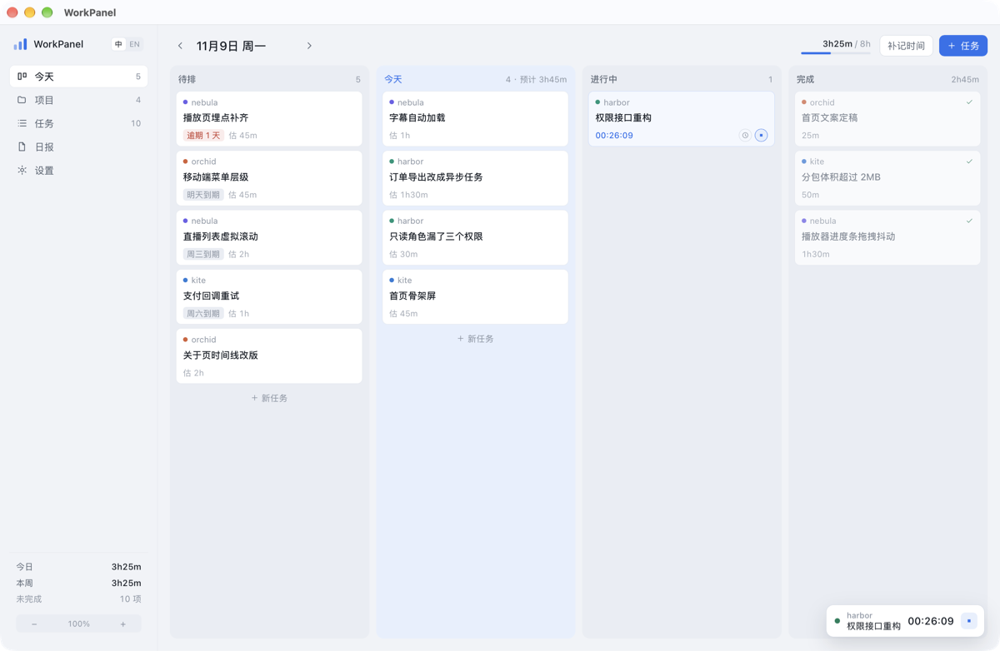
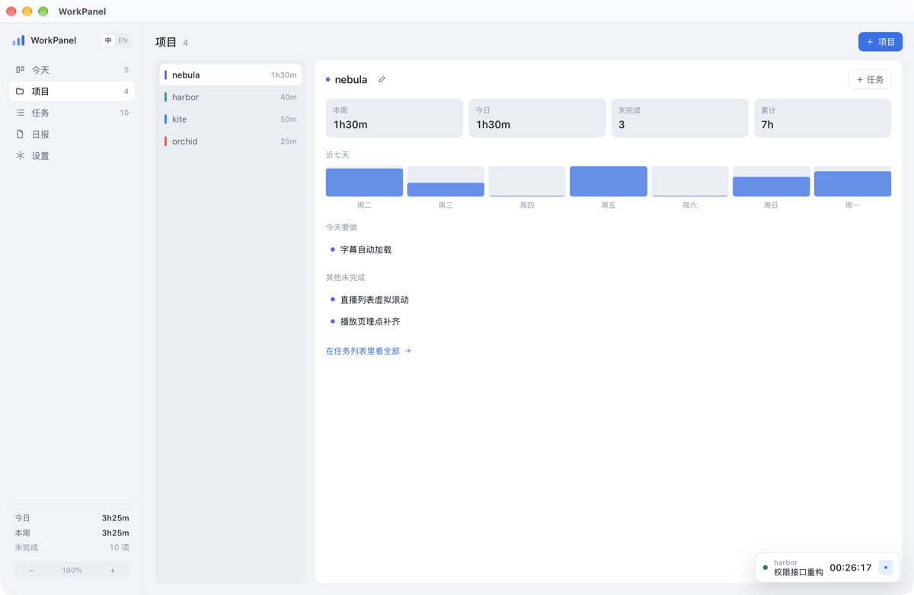
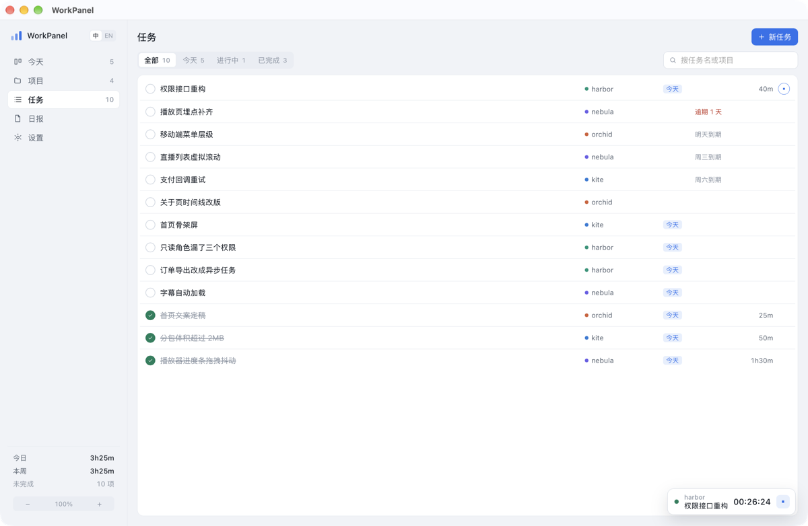
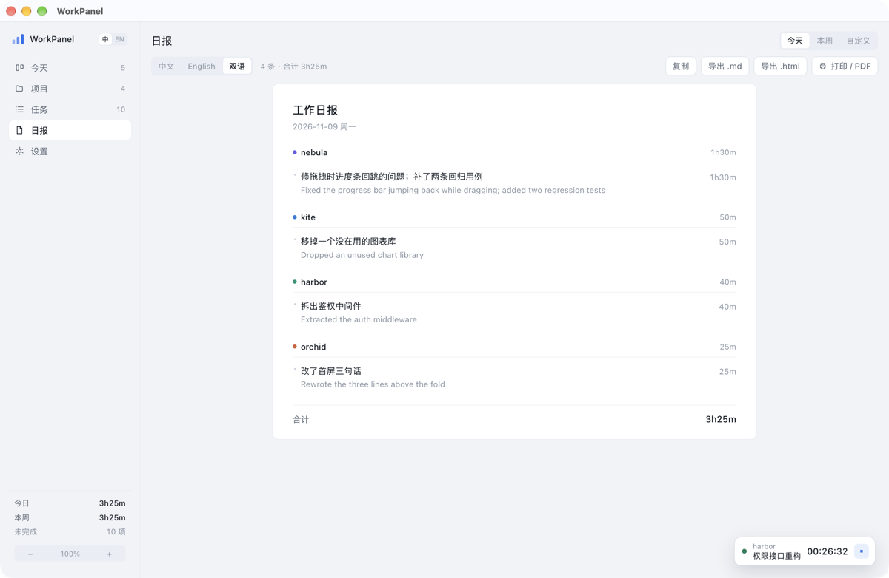

# WorkPanel

[](LICENSE)

多项目并行时的任务面板 + 工时记录 + 中英日报生成器。本地优先，数据只存这台机器。

Tauri 2 + Vue 3 写的独立桌面应用，macOS / Windows 都能跑。没有账号、没有云同步、不联网（除非你自己开 AI 英文总结）。

[English](README.md) · **中文**



> 截图里是演示数据，不是真实项目。

## 下载

到 **[Releases](https://github.com/Attiv/workpanel/releases/latest)** 取最新版：

| 平台 | 文件 | 说明 |
| --- | --- | --- |
| macOS（Apple Silicon + Intel） | `WorkPanel_*_universal.dmg` | 未签名：首次打开请右键 → 打开，或执行 `xattr -dr com.apple.quarantine /Applications/WorkPanel.app` |
| Windows x64 | `WorkPanel_*_x64-setup.exe` | 推荐；同时也提供 `.msi` |

不想装包也可以自己从源码编译，见[开发](#开发)。

## 解决什么问题

同时推进几个项目时，每天在项目之间来回切，任务常常要隔几天才做。到了下班还要交日报：每个项目做了什么、各花了多久、一两句话写清楚。

WorkPanel 把这三件事放在一个画面里：

- **任务按项目排** —— 待排 / 今天 / 进行中 / 完成四列，直接拖动卡片改计划
- **工时随手记** —— 卡片上的计时器，或者事后补一条
- **日报自动出** —— 按项目分组，一条任务一句话，中文 / 英文 / 双语

## 主要功能

### 看板

四列，任意两列之间都能拖：**待排 → 今天 → 进行中 → 完成**。

- **拖到「今天」**= 排进今天。从「进行中」拖回来会先结算正在跑的计时，卡片回到今天的待办列表。
- **拖到「进行中」**= 开始做，自动起计时；这个任务已经在计时就不再重复起。
- **拖到「完成」**= 标记完成并停表；已完成的卡片拖回「今天」会被重新打开。
- **拖到「待排」**= 取消排期，回到待排池。

每张卡片右下角有两个按钮（悬停显示）：**⏱ 手动补记** 和 **▶ 计时**。所以「这件事我忘了按开始」和「我现在就做」都能处理。

列的标题栏显示 `3 · 预计 3h45m · 已记 1h25m`，一眼看出今天的活是否排得下。

应用一直开着过夜也没关系：日期会跟着日历自己翻页，还留在「今天」的卡片会退回「待排」，不会假装还是今天的计划。

### 项目

左侧项目列表按本周工时排序，右侧显示本周 / 今日 / 未完成 / 累计四个数字、近 7 天柱状图，以及这个项目今天要做的事。



### 任务

全部任务的表格视图，可按 全部 / 今天 / 进行中 / 已完成 过滤，支持按任务名或项目名搜索。



### 备注里可以贴图

任务备注和工时记录的说明都能贴图：在对话框里任意位置 `⌘V` 粘贴截图、把图片文件拖进来，或点 `+` 选文件。缩略图排在输入框下面，点开看大图，悬停出现删除。

图片入库前会把最长边压到 1600px（能塞进体积预算就保留 PNG，否则转 JPEG），一条备注最多 12 张。图片只存在本机，**不会**进入导出的日报——日报始终是纯文字。

### 日报

选时间范围（今天 / 本周 / 自定义）和语言（中文 / English / 双语），实时生成预览。「复制中文」「复制英文」各自往剪贴板放一份纯中文 / 纯英文的 Markdown，也可以导出 `.md`、导出 `.html`、或直接打印成 PDF。

点某一条的中文行就复制那条中文，点英文行就复制那条英文——只要一条的时候不用再手动删。

还没英文的行可以点「AI 写英文总结」：不是逐字翻译，而是让 AI 读中文记录、直接用英文总结成一条日报里能用的表述——事实、术语、数字都不变，语气和句式按英文来。

同一任务的多次记录会合并成一行（说明去重后用「；」连接，最长 72 字）。



### 界面语言

界面本身支持中英切换：侧栏顶部的 `中 / EN` 开关，或设置页里的「界面语言」。选过之后会记住。

界面语言和日报语言是两件事：界面用英文，日报照样可以出中文。

### 界面缩放

窗口最小 1040×640，字小的时候可以整界面放大，布局按比例走不会错位：

| 操作 | 快捷键 |
| --- | --- |
| 放大 | `⌘ +` / `Ctrl +` |
| 缩小 | `⌘ -` / `Ctrl -` |
| 回到 100% | `⌘ 0` / `Ctrl 0` |

侧栏底部也有 `− 100% +` 三个按钮，档位是 80% / 90% / 100% / 110% / 125% / 140% / 160%，选择记在本地，下次打开还是这个大小。

### AI（可选）

只在你点日报里的「AI 写英文总结」或补记弹窗里的「改写」时才会调用，用 OpenAI 兼容接口：

| 字段 | 例子 |
| --- | --- |
| 接口地址 | `https://api.deepseek.com/v1` |
| 模型 | `deepseek-chat` |
| API Key | `sk-...` |

英文总结按中文原文缓存进本地数据库，同一条说明不会重复生成、重复计费；想换一种写法可以点「AI 重写英文总结」整份重来。

## 数据

全部数据在一个 SQLite 文件里：

| 平台 | 路径 |
| --- | --- |
| macOS | `~/Library/Application Support/com.workpanel.desktop/workpanel.db` |
| Windows | `%APPDATA%\com.workpanel.desktop\workpanel.db` |

设置页里能看到实际路径。想备份就复制这个文件；想换机器就把它拷过去。

数据库结构（5 张业务表）：

- `projects` — 项目名、颜色、别名（别名用来匹配 Kanri 里的项目前缀）
- `tasks` — 标题、备注、状态、`planned_date`（拖到哪天）、`due_date`、预估、完成时间
- `entries` — 工时事实表：哪天、哪个任务、多少分钟、做了什么。**工时只认这张表**，拖动卡片不会改工时
- `translations` — 中文原文 → 英文总结的缓存
- `attachments` — 备注里贴的图片：挂在任务或记录上，存 mime、尺寸、字节数和 BLOB。入库前已压缩，不会离开本机

## 从 Kanri 导入

设置页 →「从 Kanri 导入任务」。只读 Kanri 的数据文件，不改它：

- macOS：`~/Library/Application Support/tech.trobonox.kanri/.kanri.dat`
- Windows：`%APPDATA%\tech.trobonox.kanri\.kanri.dat`

导入规则：

- 卡片标题原样变成任务名，标题完全相同的跳过，可以重复导入
- 标题或描述里出现项目名 / 别名，就归到那个项目；没有则按标题第一个词归类（同一前缀至少出现两次才建项目）
- 列名含 done / 完成 / finished 的算已完成；`Cancel` 列也算完成，避免废弃卡片堆进待排
- `dueDate` 取前 10 位作为截止日

Kanri 的卡片没有工时字段，所以导入后工时从 0 开始。

## 开发

需要 Node 18+、pnpm、Rust 1.77+。

```bash
pnpm install
pnpm tauri dev      # 开发模式，热更新
pnpm tauri build    # 打包 .app / .msi
```

新版 macOS 上如果 DMG 打包失败（`hdiutil` 的弃用提示会让 Tauri 的打包脚本出错），只出 `.app` 即可：

```bash
pnpm build:app      # 等价于 tauri build --bundles app
```

只调前端时用 `pnpm dev`，浏览器打开 http://localhost:1420 —— 但浏览器里没有 Tauri 的命令通道，界面会报错，只能看样式。

### 目录

```
src/                     前端（Vue 3 + TS）
  components/            看板、项目、任务、日报、设置、各种弹窗
  i18n.ts                中英文案与语言切换
  store.ts               全局状态与动作（拖动、计时、增删改）
  api.ts                 invoke 封装，一一对应 Rust 命令
  types.ts               与 Rust model 对齐的类型
  styles.css             设计令牌（亮/暗色跟随系统）
src-tauri/src/
  db.rs                  建表、查询、快照、计时结算
  api.rs                 Tauri 命令
  report.rs              日报聚合与 Markdown 渲染
  ai.rs                  OpenAI 兼容接口：批量英文总结 + 单行改写
  kanri.rs               Kanri 数据导入
  tests.rs               单元测试
```

### 测试

```bash
cd src-tauri && cargo test
```

覆盖 Kanri 导入映射、去重与前缀归并、日报合并与合计、计时结算入库、拖动排期（含重开已完成任务）、英文日报取用英文总结缓存。

### 调试用环境变量

只在 debug 构建下有效：

```bash
WORKPANEL_DB=/tmp/demo.db ./src-tauri/target/debug/workpanel    # 换一个数据库文件
WORKPANEL_VIEW=report ./src-tauri/target/debug/workpanel        # 启动直接进某个视图
WORKPANEL_ZOOM=1.25 ./src-tauri/target/debug/workpanel          # 启动时临时缩放（不写回本地设置）
WORKPANEL_LANG=en ./src-tauri/target/debug/workpanel            # 以英文界面启动
WORKPANEL_MODAL=task:12 ./src-tauri/target/debug/workpanel      # 直接打开某个对话框（task:ID / entry:ID）
```

## Windows 构建

打 tag 发版时由 [release workflow](.github/workflows/release.yml) 在 Windows 机器上自动构建；下面是本机自己打的说明。

在 Windows 上跑 `pnpm tauri build` 即可，产物是 `.msi` 和 `.exe`（NSIS）。需要先装 [WebView2](https://developer.microsoft.com/microsoft-edge/webview2/)（Win10 1803+ 和 Win11 一般自带）和 [Rust MSVC 工具链](https://www.rust-lang.org/tools/install)。

数据库路径会自动切到 `%APPDATA%`，Kanri 导入路径同理，无需改代码。

## 已知取舍

- 没有云同步，也没做多设备合并。换机器靠拷数据库文件。
- 没做系统托盘和全局快捷键，计时靠窗口里的计时条。
- 任务没有子任务、没有附件，Kanri 那边有但这里刻意省掉，日报用不上。

## 许可

MIT，见 [LICENSE](LICENSE)。随便用、随便改、可以商用，保留版权声明即可。
